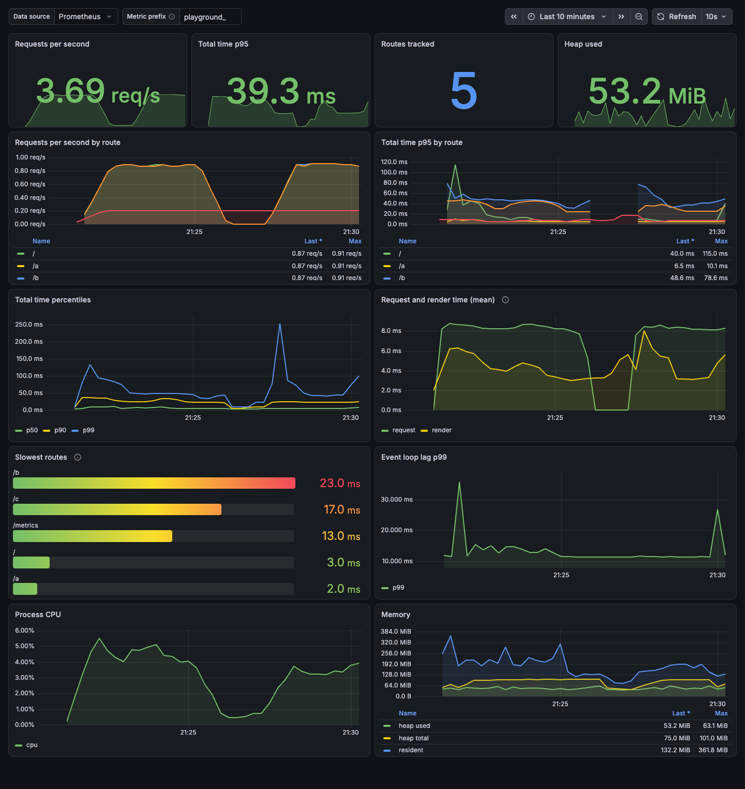

# Prometheus integration for Nuxt

Prometheus metrics for your Nuxt server. See how long each route takes, how much time goes to outbound calls, and which status code each route returns. Nuxt 2 users can use [this version](https://github.com/artmizu/analytics-nuxt-2).

## Why you want it

* Route timings with a `status_code` label. You can separate slow responses from errors.
* Histograms for request, render and total time. They work with `histogram_quantile()` in Grafana.
* Outbound call timings without network interception. HTTP/2 and gRPC keep working and are still counted.
* A Grafana dashboard with a Docker Compose stack.
* A health check route for your load balancer.

## Supported stack

| Area | Support |
|---|---|
| Nuxt | 3.x and 4.x |
| Node.js | 22.22.3+, 24.15.0+, 26+ |
| Bun | 1.3.11 (tested) |
| Deno | 2.8.3 (tested) |
| Nitro presets | `node-server`, `bun`, `deno-server` |
| Outbound calls counted | `fetch` and undici, `http` and `https`, HTTP/2, gRPC |
| Outbound calls not counted | Raw TCP connections, database clients and XMLHttpRequest |
| Grafana | [Example dashboard](./examples/grafana) |

## Routes

You can change both paths with the module options.

| Route | Purpose |
|---|---|
| `/metrics` | Prometheus metrics |
| `/health` | Health check |

## Installation

Install the package with a package manager:
```bash
# using nuxi, it automatically appends the module in your nuxt.config
npx nuxi@latest module add prometheus

# using npm
npm install @artmizu/nuxt-prometheus

# using yarn
yarn add @artmizu/nuxt-prometheus

# using pnpm
pnpm add @artmizu/nuxt-prometheus
```

Add the module to the `modules` section of your Nuxt config:
```js
export default {
  modules: ['@artmizu/nuxt-prometheus']
}
```

## Upgrading to 4.0.0

1. Use Node.js 22 (22.22.3+), 24 (24.15.0+), or 26+.
2. Update `@artmizu/nuxt-prometheus` to `4.0.0`.
3. If you register custom metrics, replace `prom-client` with `@prometheus-io/client` in your dependencies and imports:

   ```ts
   import { Counter, register } from '@prometheus-io/client'
   ```
4. Update dashboard queries to use histograms. Use `histogram_quantile()` for percentiles.
5. Add `status_code` to all page timing metric queries and dashboards. All six page metrics now include a `status_code` label:

   ```promql
   sum by (path) (
     rate(page_total_time_histogram_count{status_code=~"5.."}[5m])
   ) /
   sum by (path) (
     rate(page_total_time_histogram_count[5m])
   )
   ```

## Grafana dashboard

A ready-to-use dashboard lives in [examples/grafana](./examples/grafana), together with a Docker Compose stack that starts Prometheus and Grafana with the dashboard already provisioned.

See [examples/grafana/README.md](./examples/grafana/README.md) for the import steps, the queries behind each panel, and how to point Prometheus at your app.

## Collected Metrics

In addition to the [default Node.js metrics](https://github.com/prometheus/client_js#default-metrics) provided by `@prometheus-io/client`, this module collects the following custom metrics:

| Metric | Type | Labels | Description |
|--------|------|--------|-------------|
| `page_render_time` | Gauge | `path`, `status_code` | Time spent rendering a page (total minus external request time), in ms |
| `page_request_time` | Gauge | `path`, `status_code` | Time spent on external API requests during page processing, in ms |
| `page_total_time` | Gauge | `path`, `status_code` | Total time to complete a request, in ms |
| `page_render_time_histogram` | Histogram | `path`, `status_code`, `le` on buckets | Distribution of page render times, in ms |
| `page_request_time_histogram` | Histogram | `path`, `status_code`, `le` on buckets | Distribution of external API request times, in ms |
| `page_total_time_histogram` | Histogram | `path`, `status_code`, `le` on buckets | Distribution of total request times, in ms |

All custom metric names can be prefixed with the `prefix` option, for example `myapp_page_render_time`.

The `page_request_time` metrics include outbound `fetch`, `http`, `https`, HTTP/2 and gRPC calls. They do not include raw TCP connections or database clients.

Histograms export `_bucket`, `_sum`, and `_count` series. The `+Inf` bucket is automatic.

The gauge variants keep the last observed value per `(path, status_code)` pair and never expire, so a path that rarely returns an error can appear to have a stale sample; use the histograms for aggregation and dashboards.

SSR error renders and unmatched-route 404s are attributed to the synthetic `/__nuxt_error` path with their real status code, so per-page error rates cannot be derived from `path`. A path with no 5xx samples is absent from an error-ratio query rather than showing 0.

For the p95 total duration across replicas, in milliseconds:

```promql
histogram_quantile(0.95, sum by (le, path) (rate(page_total_time_histogram_bucket[5m])))
```

## Options
You can pass it through module options and the nuxt config property `prometheus`.

### enabled
- Type: `boolean`
- Default: `true`
- Description: Enables or disables Prometheus integration at runtime. When set to `false`, no metrics are collected and no hooks are registered. This allows you to build the app with the module but disable it in certain environments.

### verbose
- Type: `boolean`
- Default: `true`
- Description: Additional logs in the dev mode, about page rendering time and time of external API requests

### healthCheck
- Type: `boolean`
- Default: `true`
- Description: To turn on and off the healthcheck route

### healthCheckPath
- Type: `string`
- Default: `/health`
- Description: Healthcheck url path

### prometheusPath
- Type: `string`
- Default: `/metrics`
- Description: Prometheus exporter url path

### prefix
- Type: `string`
- Default: no prefix
- Description: An optional prefix for metric names

### histogramBuckets
- Type: `number[]`
- Default: `[5, 10, 25, 50, 100, 250, 500, 1000, 2500, 5000, 10000]`

A non-empty list replaces the default boundaries for all three timing histograms. An empty list uses the defaults.
Use finite, non-negative numbers in strictly increasing order. Values are in milliseconds.

```ts
export default defineNuxtConfig({
  prometheus: {
    histogramBuckets: [10, 50, 100, 250, 500, 1000],
  },
})
```

### disableRequestInterceptor
- Type: `boolean`
- Default: `false`
- Description: Disables collection of outbound request timings.

When disabled, only total page timing metrics remain available.
Request and render timing gauges and histograms are omitted because their values are unavailable.
Default Node.js metrics, `/metrics`, and `/health` remain available.

When outbound collection is active, the module enables Nitro's experimental async context by default.
This context keeps outbound request timings separate for concurrent server requests, including SSR.
Background requests without a Nitro request context do not contribute to page timings.

An explicit `nitro.experimental.asyncContext: false` remains unchanged, but outbound request timings require this feature.
See the [Nitro async context documentation](https://v2.nitro.build/guide/utils#async-context-experimental) for runtime support and limitations.

### metricsEndpoint
- Type: `boolean`
- Default: `true`
- Description: Whether to expose the `/metrics` endpoint. When set to `false`, metrics are still collected internally but the endpoint is not registered. This allows you to access metrics programmatically via the `register` object from `@prometheus-io/client` and expose them on a separate internal port.

## Runtime Environment Variables

All options can be configured at runtime via environment variables following Nuxt's convention `NUXT_PUBLIC_PROMETHEUS_<OPTION_NAME>`:

| Environment Variable | Option | Example |
|---------------------|--------|---------|
| `NUXT_PUBLIC_PROMETHEUS_ENABLED` | `enabled` | `false` |
| `NUXT_PUBLIC_PROMETHEUS_VERBOSE` | `verbose` | `false` |
| `NUXT_PUBLIC_PROMETHEUS_HEALTH_CHECK` | `healthCheck` | `false` |
| `NUXT_PUBLIC_PROMETHEUS_METRICS_ENDPOINT` | `metricsEndpoint` | `false` |
| `NUXT_PUBLIC_PROMETHEUS_PREFIX` | `prefix` | `myapp_` |
| `NUXT_PUBLIC_PROMETHEUS_HISTOGRAM_BUCKETS` | `histogramBuckets` | `[10, 100, 1000]` |
| `NUXT_PUBLIC_PROMETHEUS_DISABLE_REQUEST_INTERCEPTOR` | `disableRequestInterceptor` | `true` |

Example usage:
```bash
# Disable metrics endpoint in production while keeping collection active
NUXT_PUBLIC_PROMETHEUS_METRICS_ENDPOINT=false node .output/server/index.mjs

# Use custom prefix
NUXT_PUBLIC_PROMETHEUS_PREFIX=myapp_ node .output/server/index.mjs
```

## Development

The build uses TypeScript 5.9.3 because the current Nuxt module builder does not support the TypeScript 7 compiler API.

Outbound request timings are collected by `src/runtime/collector`. On Node.js the collector subscribes to the `undici:request:*`, `http.client.*` and `http2.client.stream.*` diagnostics channels. On Bun and Deno it wraps `fetch`, `http`, `https` and `http2.connect`, because those channels are missing or incomplete there. Neither adapter intercepts connections, so HTTP/2 and gRPC traffic works as before. Both are counted, because gRPC uses the Node.js HTTP/2 client.

```bash
# Install dependencies
pnpm install

# Prepare the module (build types and module)
pnpm run dev:prepare

# Start development server with playground
pnpm run dev

# Run tests
pnpm test
```

**Important:** After making changes to the module source code, you must run `pnpm run dev:prepare` to rebuild the module before testing.

### Memory regression check

With [k6 installed](https://grafana.com/docs/k6/latest/set-up/install-k6/), run:

```bash
pnpm test:memory
```

The PR check uses a local fixture and fails if post-GC heap growth exceeds 8 MiB after warm-up.
Logs, measurements, and a baseline heap snapshot are saved in `reports/memory`; failures also include a snapshot for comparison.
CI uploads these files as the `memory-regression` artifact.

This short check cannot detect every slow leak. The collector lifecycle test separately checks that no state accumulates for requests that never settle.
