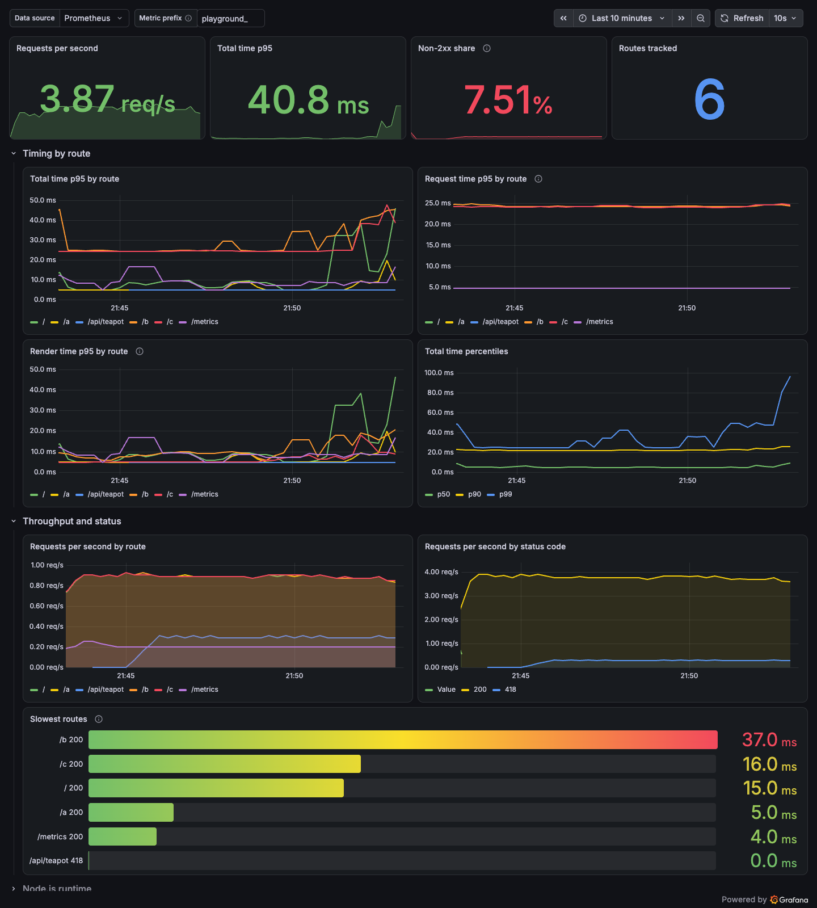

# Grafana dashboard



A dashboard for the metrics exported by `@artmizu/nuxt-prometheus` 4.x. It focuses on the module's own metrics: per-route request, render and total time, throughput, and status codes. The default Node.js metrics sit in a collapsed row at the bottom.

## Panels

| Row | Panel | Query |
| --- | --- | --- |
| | Requests per second | `sum(rate(<prefix>page_total_time_histogram_count[$__rate_interval]))` |
| | Total time p95 | `histogram_quantile(0.95, sum by (le) (rate(<prefix>page_total_time_histogram_bucket[$__rate_interval])))` |
| | Non-2xx share | `sum(rate(..._count{status_code!~"2.."}[...])) / sum(rate(..._count[...]))` |
| | Routes tracked | `count(count by (path) (<prefix>page_total_time))` |
| Timing by route | Total time p95 by route | `histogram_quantile(0.95, sum by (le, path) (rate(<prefix>page_total_time_histogram_bucket[$__rate_interval])))` |
| Timing by route | Request time p95 by route | same, on `page_request_time_histogram_bucket` |
| Timing by route | Render time p95 by route | same, on `page_render_time_histogram_bucket` |
| Timing by route | Total time percentiles | p50, p90, p99 over the total time buckets |
| Throughput and status | Requests per second by route | `sum by (path) (rate(...))` |
| Throughput and status | Requests per second by status code | `sum by (status_code) (rate(...))` |
| Throughput and status | Slowest routes | `topk(10, <prefix>page_total_time)` |
| Node.js runtime | Event loop lag, CPU, memory | default metrics from `@prometheus-io/client` |

`<prefix>` is the `prometheus.prefix` option, empty by default. Set it in the `Metric prefix` field at the top of the dashboard.

The request and render panels need the request interceptor, which is enabled by default. When `disableRequestInterceptor` is on, those metrics are not exported and the panels stay empty; total time keeps working.

SSR render errors and unmatched-route 404s are exported under the synthetic `/__nuxt_error` path with the real status code, so error traffic appears there rather than under the page you were on. The status panels read `status_code`, which requires 4.0.0 or later.

## Import into an existing Grafana

1. Open Dashboards, then New, then Import.
2. Upload `dashboard.json`.
3. Select your Prometheus data source.
4. Set the `Metric prefix` field to your configured prefix, or leave it empty.

## Run the example stack

`docker-compose.yml` starts Prometheus and Grafana with the dashboard already provisioned. It expects a Nuxt app on port 3000 with this module enabled.

```bash
# terminal 1: your app
pnpm dev

# terminal 2: Prometheus and Grafana
cd examples/grafana
docker compose up -d
```

Open http://localhost:3001. Prometheus is on http://localhost:9090.

`prometheus.yml` scrapes `host.docker.internal:3000`. Change the host and port if your app runs elsewhere.

If you use the Nuxt dev server, Vite rejects unknown `Host` headers with a 403, so scraping `host.docker.internal` fails. Either use your machine IP in `prometheus.yml` (`ipconfig getifaddr en0` on macOS), or add the host to `vite.server.allowedHosts` in `nuxt.config.ts`:

```ts
export default defineNuxtConfig({
  vite: {
    server: {
      allowedHosts: ['host.docker.internal'],
    },
  },
})
```

A production build (`nuxt build`, then `node .output/server/index.mjs`) has no host allowlist, so `host.docker.internal` works there.

To stop the stack:

```bash
docker compose down
```
